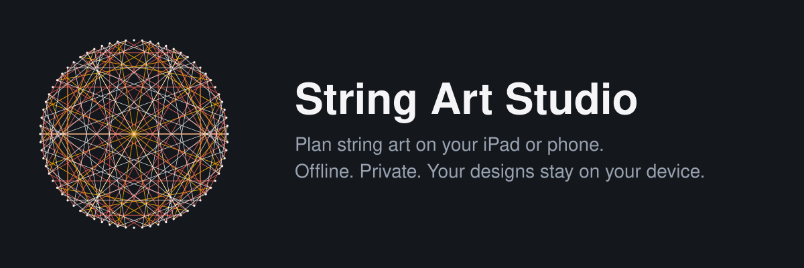

<p align="center"></p>

<p align="center"></p>

# String Art Studio

**Plan string art before you hammer a nail.**
Draw, add Hindi, Sanskrit and Gujarati text, place nails, preview threads in any color and follow along while you build.
Everything runs on the device. No server, no account, no upload.

[Run locally](#run-locally) · [Features](#features) · [Privacy](#privacy-first-by-design) · [Deploy](#deploy) · [iPad app](#ipad-and-iphone) · [Contribute](#contributing)


---

## Features

| Draw | Nails and strings | Build and keep |
| --- | --- | --- |
| Pen, freeform pen, lasso (freehand, smooth, polygon) | Nails placed along your drawing | Step through every thread in order |
| Line, square, circle, triangle, star, heart | Outline, jump and multiply patterns | Nail positions with angle and radius |
| Text in Hindi, Sanskrit, Gujarati and English | Per shape, in any color, overlaps work | Layers: hide shapes and string colors |
| Select, move, resize, rotate, pinch zoom | Edit points like a vector editor | Board colors, undo and redo |
| Mandala symmetry and mirror | Photoshop-style Pen options | My designs, project files, offline use |

## Privacy first by design

- No account, no analytics, no uploads.
- Designs are stored on the device. **Save project file** makes a backup you control.
- The Content Security Policy blocks connections to other sites. See [docs/PRIVACY.md](docs/PRIVACY.md).

## Architecture

```
React + TypeScript shell  ->  studio engine (canvas, touch tools)  ->  localStorage on the device
lib/ and services/        ->  typed, tested algorithms (geometry, nails, threads, text outlines, projects)
public/sw.js              ->  offline cache filled in at build time
```

More in [docs/ARCHITECTURE.md](docs/ARCHITECTURE.md).

## Tech stack

| Layer | Tools |
| --- | --- |
| App | React 18, TypeScript, Vite |
| Styling | Tailwind CSS for overlays, the studio's own CSS for the board UI |
| Offline | Service worker with a build-time file list, Web App Manifest |
| iPad app | Capacitor 6 (optional) |
| Checks | `tsc`, catalog verifier, QA scripts, benchmark |

## Run locally

Node 20 or newer.

```bash
npm install
npm run dev
```

## Quality checks

```bash
npm run lint           # type check
npm run test:catalog   # tools, markup ids, engine ids and PWA files agree
npm run test:qa        # needs Node 22.18+: geometry, nails, threads, text, storage, end to end
npm run benchmark      # nail generation speed on large designs
npm run build
```

## Deploy

Push to GitHub, then **Settings, Pages, Source: GitHub Actions**. The workflow in `.github/workflows/pages.yml` builds and publishes.
Cloudflare Pages and any static host also work. See [docs/DEPLOY.md](docs/DEPLOY.md).

Tagging `v1.0.0` publishes a release with a ready-to-serve ZIP. Serve it over HTTPS or localhost, not from `file://`.

## iPad and iPhone

Add to Home Screen from Safari, or build a native app with Capacitor and Xcode. See [docs/IPAD.md](docs/IPAD.md).

## Project structure

```
components/      React shell (Studio, offline badge, install prompt, update toast) and studio markup and styles
hooks/           online status, service worker, install prompt, persistent storage
lib/             geometry, constants, build-list formatting
services/        nails, threads, text outlines, projects, studio engine
scripts/         catalog verifier, QA runner, icon generator
benchmarks/      performance checks
public/          manifest, service worker, icons, headers, robots, sitemap
functions/       Cloudflare Pages security headers
design-system/   durable UI decisions and tokens
docs/            architecture, deploy, iPad, privacy
assets/          1024 px icon and splash for native iOS builds
qa-*.mjs         automated checks
```

## Roadmap

- Move the remaining engine code into typed modules in `services/`
- VoiceOver labels for tools and handles
- Tests for the select, rotate and pinch maths
- Export a printable 1:1 nail template as PDF

## Contributing

Read [CONTRIBUTING.md](CONTRIBUTING.md). The one rule: keep it offline and keep data on the device.

## Security

Please report security issues privately. See [SECURITY.md](SECURITY.md).

## License

MIT. Replace `YOUR NAME` in [LICENSE](LICENSE).
